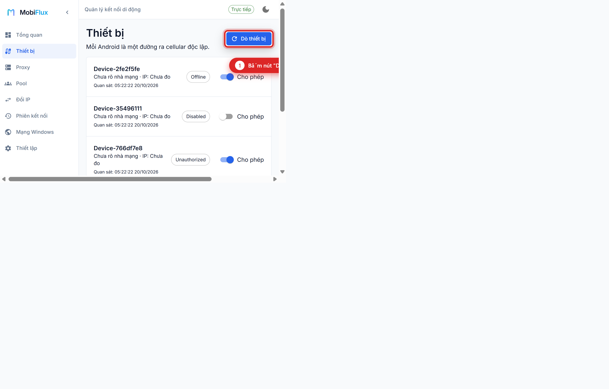
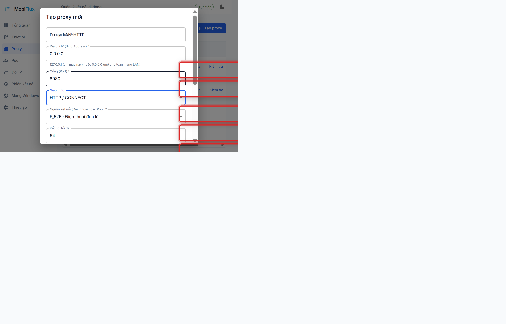
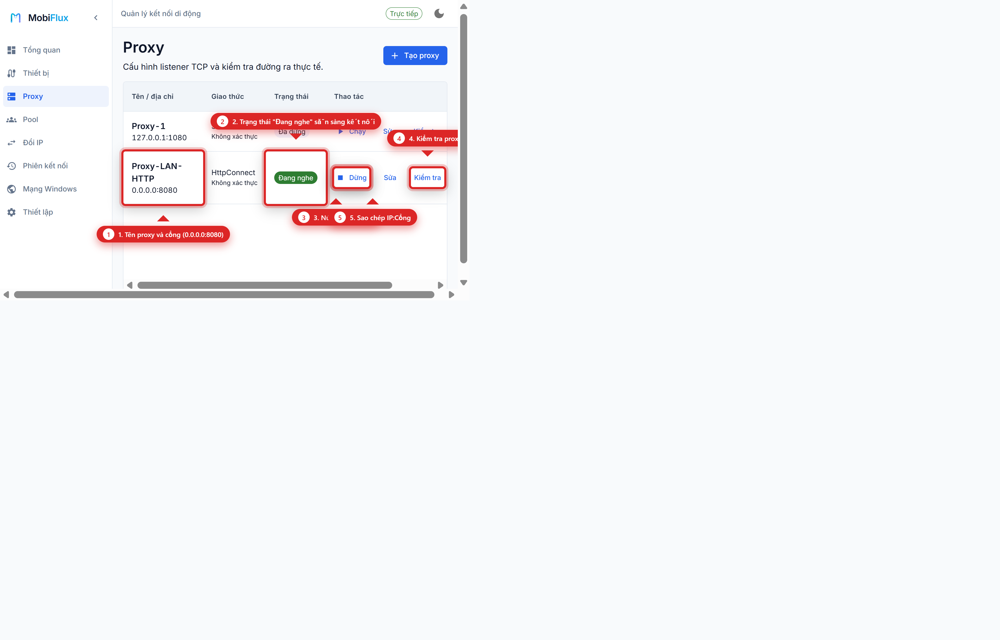
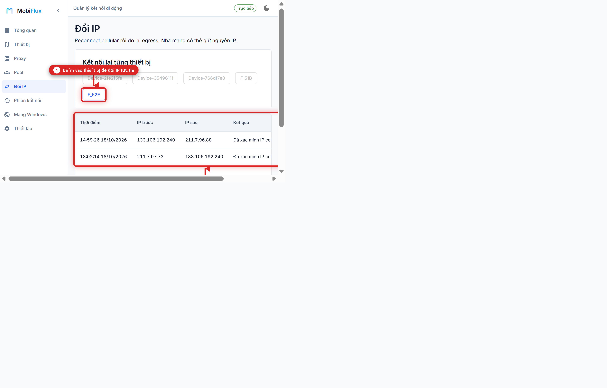

# Hướng dẫn sử dụng mobiflux

> mobiflux giúp biến điện thoại android gắn sim 4g hoặc 5g thành cổng proxy trực tiếp trên máy tính windows. mạng đi hoàn toàn qua sóng sim của điện thoại, không đụng vào mạng wifi.

---

## Mục lục

1. [Chuẩn bị điện thoại android](#1-chuẩn-bị-điện-thoại-android)
2. [Cách bật ứng dụng trên máy tính](#2-cách-bật-ứng-dụng-trên-máy-tính)
3. [Bước 1: nhận diện điện thoại cắm máy](#3-bước-1-nhận-diện-điện-thoại-cắm-máy)
4. [Bước 2: tạo cổng proxy mới](#4-bước-2-tạo-cổng-proxy-mới)
5. [Bước 3: kiểm tra và sử dụng proxy](#5-bước-3-kiểm-tra-và-sử-dụng-proxy)
6. [Bước 4: đổi ip mạng di động](#6-bước-4-đổi-ip-mạng-di-động)
7. [Cách lấy địa chỉ proxy để dùng](#7-cách-lấy-địa-chỉ-proxy-để-dùng)
8. [Sửa các lỗi thường gặp](#8-sửa-các-lỗi-thường-gặp)

---

## 1. Chuẩn bị điện thoại android

để máy tính nhận được điện thoại, bạn cần bật chế độ gỡ lỗi usb trên từng máy:

1. vào **cài đặt** trên điện thoại -> chọn **thông tin điện thoại** -> chọn tiếp **thông tin phần mềm**.
2. bấm liên tục 7 lần vào dòng **số hiệu bản tạo** (hoặc số bản dựng) cho đến khi máy báo đã bật chế độ nhà phát triển.
3. quay lại menu cài đặt chính -> vào mục **cài đặt cho người phát triển**.
4. gạt bật mục **gỡ lỗi usb** (usb debugging).
5. cắm dây cáp nối điện thoại vào máy tính. khi màn hình điện thoại hiện bảng hỏi "cho phép gỡ lỗi usb?", bạn tích chọn **luôn cho phép từ máy tính này** rồi bấm **cho phép** (hoặc ok).

> lưu ý: nếu cắm từ 3 máy trở lên, bạn nên dùng bộ chia usb có cắm nguồn phụ để không bị tụt nguồn làm ngắt kết nối.

---

## 2. Cách bật ứng dụng trên máy tính

bạn có thể mở giao diện bằng 1 trong 2 cách sau:

### Cách 1: dùng giao diện web (khuyên dùng)
1. mở powershell hoặc terminal tại thư mục mobiflux.
2. chạy lệnh mở dịch vụ nền:
   ```powershell
   Start-Process "src\MobiFlux.Service\bin\Debug\net10.0\MobiFlux.Service.exe" -WorkingDirectory "src\MobiFlux.Service"
   ```
3. mở trình duyệt (chrome, edge...) và vào địa chỉ: `http://localhost:5080`.

### Cách 2: dùng app desktop windows
chạy thêm lệnh sau để mở cửa sổ ứng dụng:
```powershell
Start-Process "src\MobiFlux.Desktop\bin\Debug\net10.0-windows\MobiFlux.Desktop.exe" -WorkingDirectory "src\MobiFlux.Desktop"
```

---

## 3. Bước 1: nhận diện điện thoại cắm máy

sau khi cắm cáp usb, bạn vào mục **thiết bị** (devices) trên menu bên trái để kiểm tra:



* **[1] Bấm dò thiết bị**: bấm nút màu xanh ở góc phải để hệ thống quét lại toàn bộ cổng usb và tìm điện thoại vừa cắm.
* **[2] Trạng thái sẵn sàng (ProxyReady)**: khi máy hiện chữ màu xanh lá cây là điện thoại đã nhận sim, có mạng 4g/5g và sẵn sàng tạo proxy. nếu hiện unauthorized thì xem lại màn hình điện thoại để bấm cho phép gỡ lỗi usb.
* **[3] Công tắc cho phép**: bạn có thể gạt tắt nếu tạm thời không muốn dùng máy đó.

---

## 4. Bước 2: tạo cổng proxy mới

khi điện thoại đã ở trạng thái sẵn sàng, bạn chuyển sang mục **proxy** rồi bấm nút **tạo proxy**:



các ô cần điền theo thứ tự từ trên xuống dưới:
* **[1] Địa chỉ IP (Bind Address)**:
  * điền `127.0.0.1` nếu chỉ muốn dùng proxy trên chính máy tính này.
  * điền `0.0.0.0` nếu muốn máy tính khác, điện thoại khác trong cùng mạng wifi/lan cũng dùng được.
* **[2] Cổng (Port)**: điền số cổng bạn muốn, ví dụ `8080`, `1080` hoặc `1081`. mỗi proxy phải dùng một cổng khác nhau.
* **[3] Giao thức**: chọn `Socks5` hoặc `HttpConnect` (thường dùng httpconnect cho web và tool antidetect).
* **[4] Nguồn kết nối**: chọn đúng tên chiếc điện thoại android bạn muốn lấy mạng.
* **[5] Nút tạo proxy**: bấm nút này để hệ thống lưu và mở cổng.

---

## 5. Bước 3: kiểm tra và sử dụng proxy

danh sách các cổng proxy bạn đã tạo sẽ hiện ở màn hình quản lý:



* **[1] Tạo proxy**: bấm khi bạn cần tạo thêm cổng proxy cho máy khác.
* **[2] Địa chỉ IP và cổng**: đây là địa chỉ kết nối của proxy (ví dụ `0.0.0.0:8080` nghĩa là đang mở cổng 8080).
* **[3] Trạng thái đang nghe**: hiển thị màu xanh lá cây báo hiệu cổng đang chạy tốt. nếu đang hiện "đã dừng", bạn chỉ cần bấm nút "chạy" ở cột thao tác.
* **[4] Kiểm tra**: bấm nút này để hệ thống thử tải mạng qua sim và báo về xem mạng có thông hay không.
* **[5] Sao chép địa chỉ**: bấm biểu tượng hai ô vuông để copy nhanh địa chỉ proxy dán vào trình duyệt hoặc tool.

---

## 6. Bước 4: đổi ip mạng di động

khi cần lấy địa chỉ ip mới từ nhà mạng, bạn vào mục **đổi IP**:



* **[1] Bấm vào tên máy**: bấm vào nút tên chiếc điện thoại (ví dụ `F_52E`). máy sẽ tự động bật và tắt chế độ máy bay trong khoảng 3 đến 5 giây để ngắt sóng và bắt lại sóng mới từ trạm phát.
* **[2] Xem lịch sử đổi IP**: bảng bên dưới sẽ ghi lại toàn bộ nhật ký gồm ip trước khi đổi, ip mới nhận được, thời gian đổi và trạng thái thành công.

---

## 7. Cách lấy địa chỉ proxy để dùng

sau khi tạo xong proxy, bạn lấy thông tin để dán vào các phần mềm như sau:

### Nếu dùng trên cùng máy tính đang cắm điện thoại
* loại proxy: `HTTP` hoặc `SOCKS5` (tùy theo lúc bạn chọn tạo).
* ip: `127.0.0.1`
* port: cổng bạn đã đặt (ví dụ `8080` hoặc `1080`).
* ví dụ định dạng: `127.0.0.1:8080`

### Nếu dùng từ máy tính khác trong cùng mạng wifi / lan
1. xem ip mạng lan của máy chủ bằng cách mở cmd và gõ `ipconfig` (ví dụ tìm thấy `192.168.10.106`).
2. trên máy phụ hoặc điện thoại khác, điền proxy dạng:
   * ip: `192.168.10.106`
   * port: `8080`

### Dán vào các trình duyệt antidetect (gologin, adspower, hidemyacc...)
1. tạo hoặc mở một profile trên tool antidetect.
2. tại mục cấu hình proxy, chọn kiểu `HTTP` (hoặc `SOCKS5`).
3. dán `127.0.0.1:8080` (hoặc ip máy chủ nếu chạy máy khác).
4. bấm nút kiểm tra proxy trên tool, khi thấy báo xanh và hiện đúng vị trí nhà mạng của sim là hoàn tất.

### Kiểm tra bằng dòng lệnh curl
bạn có thể mở powershell và thử nhanh bằng lệnh:
```powershell
# kiểm tra qua cổng http
curl.exe -x http://127.0.0.1:8080 https://api.ipify.org

# kiểm tra qua cổng socks5
curl.exe -x socks5://127.0.0.1:1080 https://api.ipify.org
```
---

## 8. Sửa các lỗi thường gặp

* **mục thiết bị báo unauthorized**:
  * nguyên nhân: chưa bấm đồng ý trên màn hình điện thoại.
  * cách sửa: mở sáng màn hình điện thoại, tìm bảng thông báo usb và bấm "cho phép". sau đó quay lại trang web bấm nút "dò thiết bị".

* **mục thiết bị báo offline**:
  * nguyên nhân: dây cáp usb bị lỏng hoặc chân cắm bị chập chờn.
  * cách sửa: rút dây cáp cắm lại hoặc đổi sang cổng usb khác trên thùng máy tính.

* **proxy không bấm chạy được hoặc báo lỗi cổng bận**:
  * nguyên nhân: số cổng đó đang bị một phần mềm khác trên máy chiếm dụng.
  * cách sửa: bấm nút sửa ở proxy đó và đổi số cổng sang số khác (ví dụ từ `8080` đổi sang `8888` hoặc `9090`).

* **máy khác trong mạng lan không kết nối được vào proxy**:
  * nguyên nhân: tường lửa windows (firewall) đang chặn cổng đến hoặc lúc tạo proxy bạn để `127.0.0.1`.
  * cách sửa:
    1. kiểm tra proxy đã được sửa bind address thành `0.0.0.0` chưa.
    2. mở powershell với quyền admin và chạy lệnh mở tường lửa cho cổng bạn dùng:
       ```powershell
       netsh advfirewall firewall add rule name="MobiFlux LAN 8080" dir=in action=allow protocol=TCP localport=8080
       ```

* **bấm nút đổi ip nhưng địa chỉ ip không đổi**:
  * nguyên nhân: trạm phát sóng nhà mạng cấp lại đúng ip cũ do ngắt kết nối quá nhanh.
  * cách sửa: đợi khoảng 10 đến 15 giây rồi bấm đổi ip lại một lần nữa.

* **chữ trong bảng danh sách bị che khuất**:
  * cách sửa: rê chuột vào ô bất kỳ để xem bảng chữ đầy đủ, hoặc nhấp đúp chuột vào thanh phân cách giữa hai tiêu đề cột để cột tự động mở rộng theo độ dài chữ.

